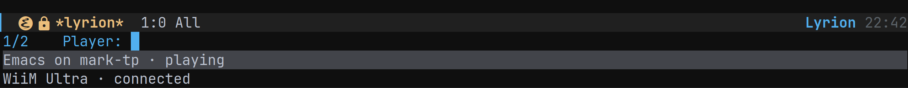
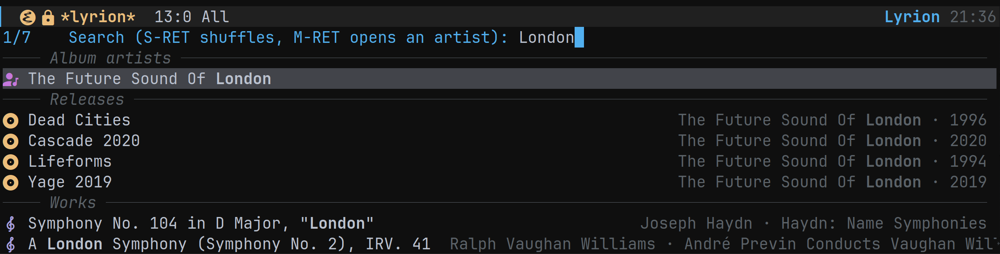
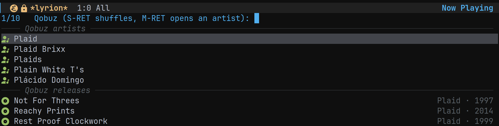
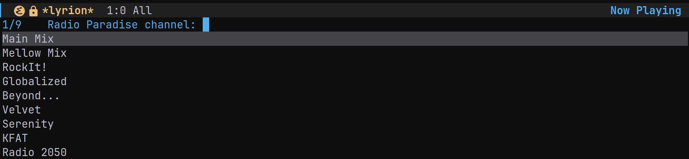
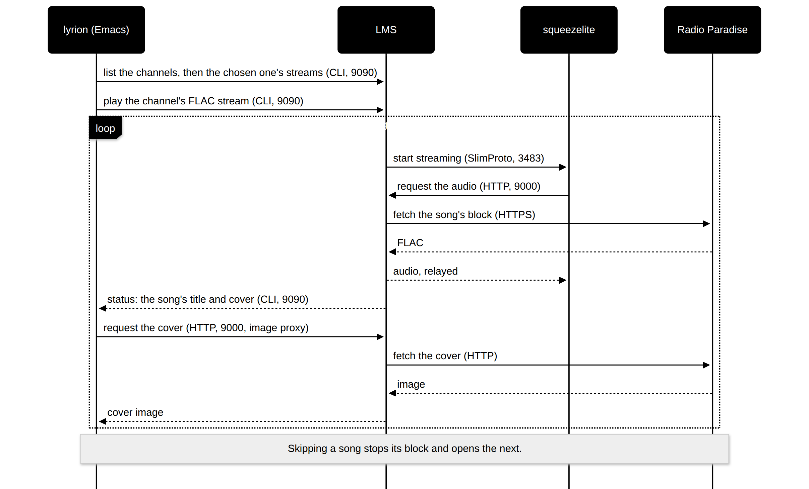

#+title: lyrion

[[https://github.com/codeasone/lyrion/actions/workflows/test.yml][https://github.com/codeasone/lyrion/actions/workflows/test.yml/badge.svg]] [[https://www.gnu.org/software/emacs/][https://img.shields.io/badge/Emacs-30.1%2B-7F5AB6.svg]] [[file:LICENSE][https://img.shields.io/badge/licence-CC0--1.0-lightgrey.svg]]

A lean Emacs front end for a [[https://lyrion.org][Lyrion Music Server]] (=LMS=).

See what's playing, search your library, and control any player on the server.

#+attr_html: :width 900px
#+attr_org: :width 900
[[file:images/screenshot.png]]

* What it does

- The now-playing buffer shows the track on a /card/ centred in the window: the cover, track, artist, album and year, a progress bar, the track up next, and the player's state, including the stream's quality, such as =FLAC 24/96= or =MP3 320 kbps=.
- Beside it, a pane shows the lyrics from =LRCLIB=. With timed lyrics, the line being sung lights up and stays in view.
- =/= searches tracks, releases, album artists, genres, works or playlists, or all of them at once. It also searches Qobuz and plays Radio Paradise when the server has their plugins.
- In search results, =RET= plays what's chosen, =S-RET= plays it shuffled, and =M-RET= on a matching artist opens their releases; =ESC= backs out a step, and =M-/= goes back to your last choice. See [[#moving-through-a-search][Moving through a search]].
- Single keys control playback, the volume, shuffle, repeat, smart crossfading, a sleep timer and the choice of player. [[#keys][Keys]] lists them all.
- =I= inspects the queue in play order and jumps to any track in it. See [[#the-queue][The queue]].
- =lyrion= can start =squeezelite= so this computer plays too, and the server keeps that player's settings between sessions.

Searches match details such as artist and year as well as names, so you can narrow the library as you type. See [[#searching][Searching]].

* Design

- =lyrion= is one file and needs only Emacs 30 or later, with its built-in =transient=. If =nerd-icons= is installed, it uses it for icons.
- The server owns the queue, along with each player's shuffle, repeat and crossfade settings. Choosing something to play replaces the queue on the server, and =<= and =>= move through it there. =lyrion= can ask the server to shuffle the queue, but never adds, removes or moves tracks in it itself, nor keeps a copy; inspecting it with =I= fetches it afresh each time.
- Nothing is polled. =lyrion= keeps one connection open to the server's CLI and subscribes to the player's status. The server sends the full status whenever anything changes, and Emacs counts the elapsed time in between.
- Covers come from the server's web port and lyrics from =LRCLIB=, and every request has a timeout.
- Search fetches the library from the server once per session, starting in the background as soon as the search menu opens. It does so over connections of its own, so a long listing never delays updates to the now-playing card.
- The now-playing and lyrics buffers are =special-mode= buffers: single keys run commands, and there is nothing to edit. Both take the same keys.
- Everything is meant to be done from the keyboard, and =?= lists every key. Mouse support is not a goal; whatever a click does comes from Emacs itself.

#+attr_html: :width 900px
#+attr_org: :width 900
[[file:images/dispatch.png]]

* Install

#+begin_src elisp
(use-package lyrion
  :vc (:url "https://github.com/codeasone/lyrion" :rev :newest)
  :custom
  (lyrion-host "lms.lan"))
#+end_src

=M-x lyrion= opens the now-playing buffer, showing whichever player is playing. To play on this computer or pick a player, see [[#the-player][The player]].

=lyrion= works with any completion UI, but =vertico= is a match made in heaven.

* Getting started

=lyrion= needs an =LMS= server ~lyrion-host~ that it can reach, and a player to show.

** The server
:PROPERTIES:
:CUSTOM_ID: the-server
:END:

=LMS= listens on three ports, shown here with their defaults. If yours uses others for the CLI or the web server, set ~lyrion-cli-port~ or ~lyrion-http-port~ accordingly.

| Port | What =LMS= serves there                                        | Used by                                |
|------+----------------------------------------------------------------+----------------------------------------|
| 9090 | the CLI: commands, and status sent as it changes               | =lyrion=                               |
| 9000 | its web server: the web interface, JSON-RPC, covers, and audio | =lyrion= for covers; players for audio |
| 3483 | [[https://wiki.lyrion.org/index.php/SlimProto_TCP_protocol.html][SlimProto]], which tells players what to play and when           | players, such as =squeezelite=         |

The diagram follows a track from the moment you choose it to its cover appearing. =lyrion= sends commands and receives status; it never handles the audio.

#+attr_html: :width 572px
#+attr_org: :width 572
[[file:images/ports.png]]

Qobuz takes a different route, as shown under [[#qobuz][Qobuz]].

** The player
:PROPERTIES:
:CUSTOM_ID: the-player
:END:

~lyrion-player~ chooses the player to show: one the server already has, or this computer.

*** An existing player

For a network streamer or a =squeezelite= on another machine, set ~lyrion-player~ to the player's name as =LMS= shows it. Case does not matter, and its internal id - the MAC address - works too. If no player has that name, the now-playing card says so and keeps looking. If ~nil~, =lyrion= shows whichever player is playing, or failing that the first one connected.

For example, to show and control a WiiM Ultra whenever =lyrion= opens:

#+begin_src elisp
(use-package lyrion
  ;; ...
  :custom
  (lyrion-host "lms.lan")
  (lyrion-player "WiiM Ultra"))
#+end_src

=p= switches players for the rest of the session. This computer is always on the list, and choosing it starts =squeezelite=.

#+attr_html: :width 900px
#+attr_org: :width 900

*** This computer
:PROPERTIES:
:CUSTOM_ID: this-computer
:END:

These steps are for Linux. =squeezelite= runs on macOS and Windows too, so they should adapt; pull requests adding instructions for either are welcome.

1. Install =squeezelite=, for example with =sudo apt install squeezelite=.
2. If the package enabled its own system service, disable it with =sudo systemctl disable --now squeezelite=. The service would run a second player that may hold the sound card.
3. =squeezelite -l= lists the output devices. If the default does not play, pass one of those names through ~lyrion-squeezelite-arguments~, such as =("-o" "pipewire")=.
4. Set ~lyrion-player~ to ~local~ and run =M-x lyrion=:

   #+begin_src elisp
   (use-package lyrion
     ;; ...
     :custom
     (lyrion-host "lms.lan")
     (lyrion-player 'local))
   #+end_src

If something after =squeezelite= controls the level, such as the system volume, a DAC or an amplifier, set ~lyrion-local-volume~ to ~100~. =squeezelite= then sends the audio without digital attenuation, and the level is set once, downstream, which preserves the signal-to-noise ratio.

#+begin_quote
*Warning:* do not set ~lyrion-local-volume~ to ~100~ if nothing after =squeezelite= controls the level, for example when a sound card or DAC feeds a power amplifier directly. The output is then full scale and can damage speakers or hearing. When configured, =lyrion= applies the setting every time it starts =squeezelite=, so a lower level set in =LMS= does not last.
#+end_quote

The player joins the server's list when it connects. Its name is ~lyrion-squeezelite-name~, ="Emacs on <hostname>"= by default. Its address derives from the name, so the server keeps its settings, such as volume and ReplayGain, between sessions. A new name makes a new player.

If the now-playing card stays on "Waiting for Emacs on <hostname> to connect" (or the name you gave the player), check that this computer can reach port 3483 on the server. If it connects but plays no sound, check port 9000. =squeezelite='s own output can be inspected in the =*lyrion squeezelite*= buffer.

=squeezelite= keeps running after the now-playing buffer is closed, so the music doesn't stop. =M-x lyrion-local-player-stop= stops it, as does killing =*lyrion squeezelite*= or quitting Emacs.

With crossfading on, the first track after =squeezelite= starts cannot be paused, because of a bug in =squeezelite=; see [[#known-issues][Known issues]].

* Keys
:PROPERTIES:
:CUSTOM_ID: keys
:END:

In the now-playing and lyrics buffers:

| Key     | Action                                                              |
|---------+---------------------------------------------------------------------|
| =SPC=   | play or pause                                                       |
| =<= =>= | previous or next track                                              |
| =←= =→= | skip back or forward by ~lyrion-skip-seconds~                       |
| =+= =-= | volume up or down by ~lyrion-volume-step~; ~=~ also turns it up     |
| =S=     | turn shuffle on or off; the track playing carries on                |
| =S-RET= | shuffle the queue afresh and play it from the top                   |
| =O=     | play the queue in order, from its first track                       |
| =R=     | cycle repeat through off, track and all                             |
| =X=     | turn smart crossfading on or off                                    |
| =I=     | inspect the queue and jump to a track                               |
| =/=     | open the search menu                                                |
| =M-/=   | go back to the last search, where you chose                         |
| =P=     | choose a Radio Paradise channel, as =/= =P= does                    |
| =p=     | choose the player                                                   |
| =w=     | copy the track as "Artist - Release - Title"                        |
| =Z=     | sleep in 15 to 90 minutes, fading out, or cancel it                 |
| =g=     | reconnect, or in the lyrics, fetch them again                       |
| =L=     | show or hide the lyrics                                             |
| =C=     | copy the lyrics shown, without times or empty lines                 |
| =q=     | hide the lyrics, or bury the now-playing buffer                     |
| =?=     | show every key in a menu, labelled with repeat, crossfade and sleep |

=/= opens a transient menu:

#+attr_html: :width 900px
#+attr_org: :width 900
[[file:images/search-menu.png]]

=q= and =P= appear only when the server has the respective Qobuz or Radio Paradise plugins installed and configured. =M-/= appears once a search has played something. The playback keys work in the menu too and keep it open, as does =L= for the lyrics.

=ESC= backs out of a search one step at a time, =C-g= leaves it at once, and =M-/= returns to your last choice; see [[#moving-through-a-search][Moving through a search]].

Above the searches, switches choose the categories that an /Everything/ search (=/=) and a Qobuz search (=q=) include by default. All are on at first; toggle a switch's key to turn it off or on again. Searching one category, such as =t= for tracks, ignores the switches.

| Switch | Category                                 |
|--------+------------------------------------------|
| =-a=   | artists: album artists, or Qobuz artists |
| =-g=   | genres (library only)                    |
| =-p=   | playlists                                |
| =-r=   | releases                                 |
| =-w=   | works (library only)                     |
| =-t=   | tracks                                   |

Switches last only while the menu is open, unless you keep them with one of transient's own persistence options, which work in any transient menu:

- =C-x s= sets them for the rest of this Emacs session.
- =C-x C-s= saves them for later sessions too, in transient's =transient-values-file=. The menu's heading reminds you of this key.

* Searching
:PROPERTIES:
:CUSTOM_ID: searching
:END:

Each result has an icon for its kind and some dimmed details: a track shows its artist and album, a release its artist and year, and a work its composer and release. A work recorded on several releases gives one result per release, so you can choose the recording; works need =LMS= 9 or later. When two results have the same text, a number tells them apart.

The details match what you type too, so =hiromi clair= narrows the many recordings of Clair de Lune to Hiromi's. In a release search, an artist's name lists their releases with their years, and a year such as =1983= lists what came out that year.

Results are sorted alphabetically, ignoring case. An /Everything/ search groups them in this order: album artists, genres, playlists, releases, works and tracks, leaving out any you have switched off.

If you use =prescient= with =vertico=, through =vertico-prescient=, your three most recent and frequent choices among the results come first, under /Recent/, and the rest stay in alphabetical order. ~lyrion-search-recent~ sets how many; 0 leaves every result in alphabetical order. Without it, the results stay alphabetical, grouped as above.

#+attr_html: :width 900px
#+attr_org: :width 900

With =vertico=, a result too wide for the window is shortened with an ellipsis, details first. The selected result scrolls to its end and back, so you can read it all; set ~lyrion-search-scroll~ to ~nil~ to stop that behaviour if you don't like it. Inspecting long queue items scrolls the same way.

=g= in the now-playing buffer lists the library again at the next search.

Please keep in mind that search is only as good as your collection's tags.

** Playing what you choose
:PROPERTIES:
:CUSTOM_ID: choosing
:END:

Every search ends in a completion list, and the key you choose a result with decides what happens to it. The same three keys work in every search, of the library or of Qobuz:

| Key     | What happens to the result                                                     |
|---------+--------------------------------------------------------------------------------|
| =RET=   | it plays, in order                                                             |
| =S-RET= | it plays, shuffled                                                             |
| =M-RET= | an artist lists their releases to pick from; anything else plays as with =RET= |

What plays depends on the kind of result:

| Result                             | What =RET= and =S-RET= play                                  |
|------------------------------------+--------------------------------------------------------------|
| a track                            | the track on its own                                         |
| a release                          | the whole release                                            |
| an album artist                    | everything by them                                           |
| a genre                            | everything in it                                             |
| a work                             | the recording on that release                                |
| a playlist                         | the whole playlist                                           |
| a Qobuz artist                     | up to 200 of their songs, as Qobuz ranks them for their name |
| a Qobuz release, track or playlist | the release, track or playlist                               |

Among an artist's releases, =RET= plays the one you pick and =S-RET= shuffles it. The prompt names the keys, and mentions =M-RET= whenever there are artists among the results.

** Moving through a search
:PROPERTIES:
:CUSTOM_ID: moving-through-a-search
:END:

/This part is opinionated./ =lyrion= treats a search as a path you can walk back along, and return to later. Emacs prompts do not usually behave this way. If it does not suit you, =C-g= always leaves at once, as anywhere in Emacs.

A search is a path of two steps, the menu and the results, and a third when =M-RET= opens an artist's releases. Three keys move along it:

- =ESC= goes back one step.
- =C-g= leaves the search at once, from any step.
- =M-/= returns to the step where you last chose something to play.

*** ESC: one step back

With =/ q=, a search for Chick Corea, and =M-RET= on the artist, three presses of =ESC= take you back out:

| You are at        | =ESC= takes you to                        |
|-------------------+-------------------------------------------|
| the releases      | the Qobuz results, on Chick Corea         |
| the Qobuz results | the search menu, with its switches as set |
| the search menu   | where you were before =/=                 |

Changed your mind after =/ r=? Press =ESC=, then =t= for a track search instead.

*** M-/: back to your last choice

After a search plays something, =M-/= opens it again at the step where you chose, with your choice selected in the full list. =ESC= then goes back as before, each step selecting what you chose there.

Say you press =/ a=, choose Chick Corea with =M-RET=, then play one of his releases. Later, =M-/= shows his releases again, on the one you played. =ESC= takes you to the album artists, on Chick Corea, so you can choose another artist.

All of this is far easier to use than to describe. Press =M-/= a few times and it will make sense long before this section does ;-)

* Qobuz
:PROPERTIES:
:CUSTOM_ID: qobuz
:END:

When the server has the [[https://www.qobuz.com][Qobuz]] plugin, =q= in the search menu searches Qobuz and streams what you choose.

It searches whichever of artists, playlists, releases and tracks are switched on; works and genres exist only in the library. Results are grouped as in an /Everything/ search, each group in Qobuz's order, most relevant first, and ~lyrion-qobuz-results~ sets how many come back in each. What each result plays is under [[#choosing][Playing what you choose]].

To narrow one search, end it with a colon, then the kinds you want and how many of each, either or both. The kinds use the search menu's letters: =a= artists, =p= playlists, =r= releases and =t= tracks. Letters override the menu's switches for that search.

| You type           | Qobuz shows                                    |
|--------------------+------------------------------------------------|
| =plaid:5=          | the top five of each kind switched on, as here |
| =honesty:t=        | tracks only                                    |
| =honesty:t5=       | the top five tracks                            |
| =joel honesty:rt3= | the top three releases and three tracks        |

Anything else after a colon, as in =Mahler: Symphony No. 9=, is searched as typed.

#+attr_html: :width 900px
#+attr_org: :width 900

If you install the plugin while =lyrion= is running, press =g= in the now-playing buffer so the search menu finds it.

The audio does not pass through =LMS=. For each track, =LMS= asks Qobuz for a signed address on its content delivery network, and the player streams from there over HTTPS. Covers come from Qobuz through =LMS='s image proxy.

#+attr_html: :width 800px
#+attr_org: :width 800
[[file:images/qobuz.png]]

** Setting up the plugin

You need a Qobuz subscription. In the =LMS= web interface:

1. Open /Settings/, then /Manage Plugins/. =LMS= downloads its list of plugins from the =LMS= community's repository on GitHub.
2. Find Qobuz under /Streaming Services/, or type its name in the search box. Tick it, apply the change and let =LMS= restart.
3. Open the Qobuz plugin's settings and sign in with your Qobuz account.
4. Set the options below, and save.

These settings suit =lyrion=. Leave the others at their defaults.

| Setting                                  | Value       | Why                                                                                                                                                     |
|------------------------------------------+-------------+---------------------------------------------------------------------------------------------------------------------------------------------------------|
| Import                                   | No          | Imported Qobuz favourites would join the library and appear among library results.                                                                      |
| Play samples                             | off         | A track Qobuz will not stream would otherwise play as a 30-second sample, marked only by an asterisk.                                                   |
| Show Release Year with Albums            | Yes         | Releases then show their year in the results.                                                                                                           |
| Show Composer with Artist                | Yes         | Classical results then name the composer as well as the performers.                                                                                     |
| Show recording version with track titles | Yes         | Track titles then tell remasters and live recordings apart.                                                                                             |
| Preferred format                         | your choice | It applies to every player, and a player can only lower it. To cap this computer at CD quality, set ~lyrion-squeezelite-arguments~ to =("-r" "44100")=. |

* Radio Paradise

When the server has the [[https://radioparadise.com][Radio Paradise]] plugin, =P=, in the search menu or straight from the player or the lyrics, lists its channels, such as Main Mix and Mellow Mix. The channel you choose replaces the queue and plays in FLAC, the best of its streams, which also allows skipping songs.

#+attr_html: :width 900px
#+attr_org: :width 900

=LMS= relays the stream one song at a time, each with its own title and cover, so the card follows the songs as the channel plays. A channel has no queue or order, so the card leaves out shuffle, repeat, crossfade and the track up next, and their keys are greyed out.

#+attr_html: :width 762px
#+attr_org: :width 762

* The queue
:PROPERTIES:
:CUSTOM_ID: the-queue
:END:

=I= inspects the queue in the order it plays, shuffled or not, whatever your completion UI would otherwise sort by.

Shuffling reorders the queue on the server, which then plays it straight through in that order, so =I= always shows what comes next. Turning shuffle off with =S= puts the queue back in its original order without interrupting the track playing. Play carries on from that track's place in the original order, so any tracks before it there are passed over.

- The track playing is marked ▶, and with =vertico= the cursor starts on it, so the tracks around it are a few keys away.
- Each line shows the track's title, artist and album, and all of them match what you type, so =planet= finds any title with that word.

=RET= plays the chosen track where it stands, without reloading or reshuffling the queue; on the track already playing, it starts it again. With =vertico=, the queue stays open, so you can hop between tracks until one suits, then close it with =C-g=. Other completion UIs close the queue as the track starts.

=S-RET= shuffles the queue afresh, as =S-RET= in the player does, and shows it again in its new order, on the track that now plays first.

#+attr_html: :width 900px
#+attr_org: :width 900
[[file:images/queue.png]]

* Crossfading

=X= turns smart crossfading on or off. In =LMS='s words, "successive tracks played from the same album will not use the Crossfade setting", so albums stay gapless, though before =LMS= 9.2 it may not fade between albums either. The fade's length, shown on the card as in /smart crossfade 10 s/, is the player's own setting, in its audio settings in the =LMS= web interface.

On this computer's player, crossfading stops the first track after =squeezelite= starts from being paused; see [[#known-issues][Known issues]].

* Lyrics

=lyrion= fetches lyrics from [[https://lrclib.net][LRCLIB]] only while they are shown, sending the track's artist, title, album and length. Answers are kept for the session; =g= in the lyrics fetches them again.

Timed lyrics are best effort. Anyone can add lyrics to LRCLIB, anonymously, so timings are only as good as whoever synced them, and the match found may be a different edit or master. Lines can light up a little early or late, or drift as the song goes on. =lyrion= lights each line 0.3 s early, as singers tend to come in slightly ahead.

* Authentication

Not supported yet. =lyrion= connects without a user name or password, which suits a home server with password protection off.

* Options

| Option                           | Default                  | Meaning                                                                                 |
|----------------------------------+--------------------------+-----------------------------------------------------------------------------------------|
| ~lyrion-host~                    | ="localhost"=            | the server                                                                              |
| ~lyrion-cli-port~                | ~9090~                   | its CLI                                                                                 |
| ~lyrion-http-port~               | ~9000~                   | its web server, for covers                                                              |
| ~lyrion-player~                  | ~nil~                    | a player's name or id, ~local~, or ~nil~ for the one playing                            |
| ~lyrion-squeezelite-program~     | ="squeezelite"=          | the program that makes this computer a player                                           |
| ~lyrion-squeezelite-name~        | ="Emacs on <hostname>"=  | this computer's player's name; its address derives from it                              |
| ~lyrion-squeezelite-arguments~   | ~nil~                    | further arguments, such as =("-o" "pipewire")=                                          |
| ~lyrion-squeezelite-idle-close~  | ~5~                      | seconds of silence before the sound device is released                                  |
| ~lyrion-local-volume~            | ~nil~                    | volume set on this computer's player when it starts; see [[#this-computer][This computer]] before using 100 |
| ~lyrion-skip-seconds~            | ~10~                     | seconds the arrow keys skip                                                             |
| ~lyrion-volume-step~             | ~5~                      | the volume change per key press, out of 100                                             |
| ~lyrion-cover-size~              | ~32~                     | the cover's longest side, in em                                                         |
| ~lyrion-progress-width~          | ~32~                     | the progress bar's width, in columns                                                    |
| ~lyrion-message-seconds~         | ~3~                      | seconds a notice such as /Playing .../ stays in the echo area; ~nil~ keeps it           |
| ~lyrion-reconnect-delay~         | ~5~                      | seconds to wait before reconnecting after a drop                                        |
| ~lyrion-lyrics-url~              | ~https://lrclib.net/api~ | where the lyrics come from                                                              |
| ~lyrion-lyrics-side~             | ~right~                  | the side the lyrics open on                                                             |
| ~lyrion-lyrics-size~             | ~0.4~                    | their share of the frame                                                                |
| ~lyrion-lyrics-select-window~    | ~t~                      | move point into the lyrics when they open                                               |
| ~lyrion-lyrics-hide-empty-lines~ | ~t~                      | leave out lines with no words                                                           |
| ~lyrion-qobuz-results~           | ~100~                    | the most Qobuz results shown of each kind                                               |
| ~lyrion-search-scroll~           | ~t~                      | scroll the selected result when too wide (=vertico=)                                    |
| ~lyrion-search-recent~           | ~3~                      | the most recent choices shown first, under /Recent/ (=prescient=)                       |

* Waiting for the server

A few commands need an answer from the server before they can show anything, and Emacs waits for it. On a home network most waits are too short to notice. These are the times measured against my own server, =LMS= 9.1.2:

| Command                   | Waits for                                       | Typical wait   | Gives up after |
|---------------------------+-------------------------------------------------+----------------+----------------|
| =p=                       | the server's players                            | 0.01 s         | 5 s            |
| =I=                       | the queue                                       | 0.01 s         | 5 s            |
| =/= =P=                   | Radio Paradise's channels                       | 0.01 s         | 5 s            |
| =/= =q=                   | a Qobuz search, which the server asks Qobuz     | 1.2 s          | 15 s           |
| =/= =t=, =r=, =a=, ...    | the library, listed once a session              | up to 1.6 s    | 30 s           |
| =M-RET= on an artist      | their releases                                  | 0.04 s         | 5 s            |
| =M-RET= on a Qobuz artist | their releases, which the server asks Qobuz for | 0.06 to 0.24 s | 15 s           |

Apart from Qobuz searches, a wait is noticeable only when the server stops answering. After a second, the echo area says what =lyrion= is waiting for, and =C-g= stops the wait at once. When =lyrion= already knows that the connection is down, it says so straight away instead of waiting.

* Known issues
:PROPERTIES:
:CUSTOM_ID: known-issues
:END:

** The first track after =squeezelite= starts cannot be paused when crossfading is on

With crossfading on, the first track this computer's player plays after =squeezelite= starts cannot be paused. =SPC= does nothing, and neither does pausing from the =LMS= web interface or any other app. Pausing works again once the next track begins. This happens every time =squeezelite= starts while the server has something to play, such as after restarting Emacs, because the server then carries on with the queue.

It is a bug in =squeezelite= itself, not in =lyrion= or =LMS=, and is present in =squeezelite= 1.9.9 and in the latest version at the time of writing, 2.0.0-1613. With crossfading on, =squeezelite= enlarges its output buffer as the first track starts and loses track of where that track begins, so it never tells the server the track has started. Until it does, the server treats the player as still buffering and ignores pausing. Later tracks are not affected, and nor are other players such as network streamers.

A fix is proposed upstream in [[https://github.com/ralph-irving/squeezelite/pull/286][squeezelite#286]]. Until a release includes it:

- Press =>= to skip to the next track, or wait for it. Pausing then works for the rest of the session.
- Or turn crossfading off for this computer's player with =X=. This takes effect from the next time =squeezelite= starts.
- Or build =squeezelite= with the fix and point ~lyrion-squeezelite-program~ at it. On Debian or Ubuntu, for example:

  #+begin_src sh
  sudo apt install libasound2-dev libflac-dev libmad0-dev libmpg123-dev libvorbis-dev libfaad-dev libopusfile-dev
  git clone -b codeasone/crossfade-first-track-start https://github.com/codeasone/squeezelite.git ~/src/squeezelite
  make -C ~/src/squeezelite
  #+end_src

  #+begin_src elisp
  (setopt lyrion-squeezelite-program (expand-file-name "~/src/squeezelite/squeezelite"))
  #+end_src

  Once a =squeezelite= release includes the fix, go back to the packaged one.

* Tested on

=lyrion= has only been tested on my own system:

| Part          | What I use                                                                              |
|---------------+-----------------------------------------------------------------------------------------|
| Desktop       | Linux Mint 22.3, kernel 7.0, X11                                                        |
| Emacs         | GNU Emacs 30.2 (GTK3, native compilation), with =vertico=, =prescient= and =nerd-icons= |
| Sound         | PipeWire 1.0.5, through its PulseAudio server                                           |
| =squeezelite= | 1.9.9, and 2.0.0-1613 with the fix from [[https://github.com/ralph-irving/squeezelite/pull/286][#286]]                                  |
| Server        | =LMS= 9.1.2, the =lmscommunity/lyrionmusicserver= Docker image on Debian 12             |
| Players       | this computer, through =squeezelite=, and a [[https://www.wiimhome.com/wiimultra/overview][WiiM Ultra]]                                  |

I haven't tried it on macOS, Windows or Wayland, with a completion UI other than =vertico=, or with a server older than =LMS= 9. CI covers Emacs 30.1, the oldest version =lyrion= supports.

* AI assistance

=lyrion= was developed with Claude Opus 5.5 in Claude Code: it wrote the code, the tests and the first drafts of this documentation. I set the design, guided the implementation and the quality checks, reviewed the code, revised the documentation, and tested =lyrion= against my own =LMS= server.

I never intended to share "AI-written" work on my GitHub profile, but =lyrion= has worked out so nicely that I feel compelled to.

If it serves no other purpose than to inspire remixes of your own, that's reason enough.

* Licence

=lyrion= is dedicated to the public domain under [[https://creativecommons.org/publicdomain/zero/1.0/][CC0 1.0 Universal]]: use it, change it and share it however you like, with no need to ask or credit anyone. No copyright is claimed, since the code was written by an AI model; where the law does not allow a waiver, CC0 grants the same freedoms as a licence. The full text is in =LICENSE=.

=lyrion= is not affiliated with or endorsed by the Lyrion Music Server project.

* Development

=make test= runs the test suite.

=make lint= byte-compiles with warnings as errors and runs =checkdoc=.

=make coverage= runs the tests under [[https://github.com/undercover-el/undercover.el][undercover]], which it installs into =.deps= the first time, and writes an lcov report to =coverage/lcov.info=. It fails when the tests run less than =COVERAGE_MIN= per cent of =lyrion.el=, 90 by default.

These targets run Emacs headless, with no display or input. The tests talk to a fake server on loopback ports, so you don't need a real =LMS=. On every push and pull request, GitHub Actions runs =make lint= and =make coverage= on Emacs 30.1, and keeps the lcov report with the run.

The sequence diagrams are drawn from =images/ports.mmd=, =images/qobuz.mmd= and =images/radio-paradise.mmd=. After changing one, render it again with =mmdc -i images/NAME.mmd -o images/NAME.png -b white -s 2=.
