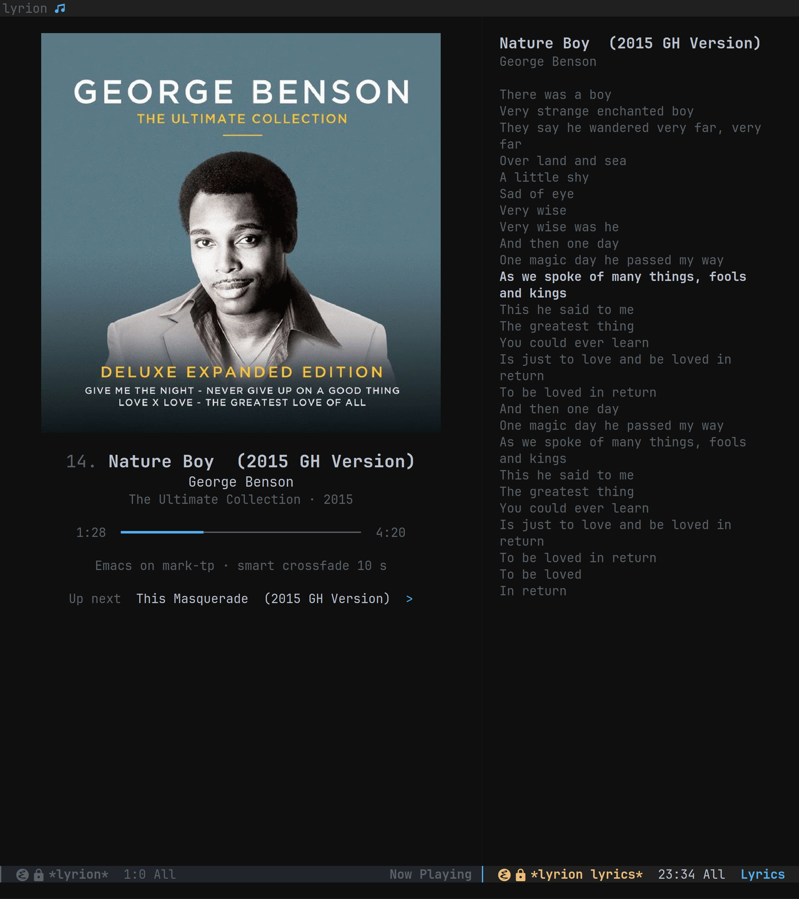
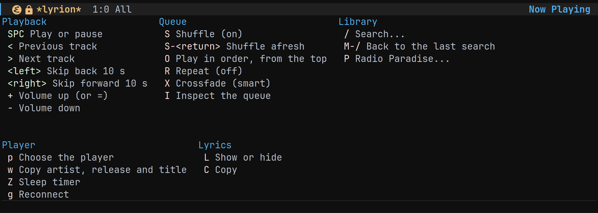
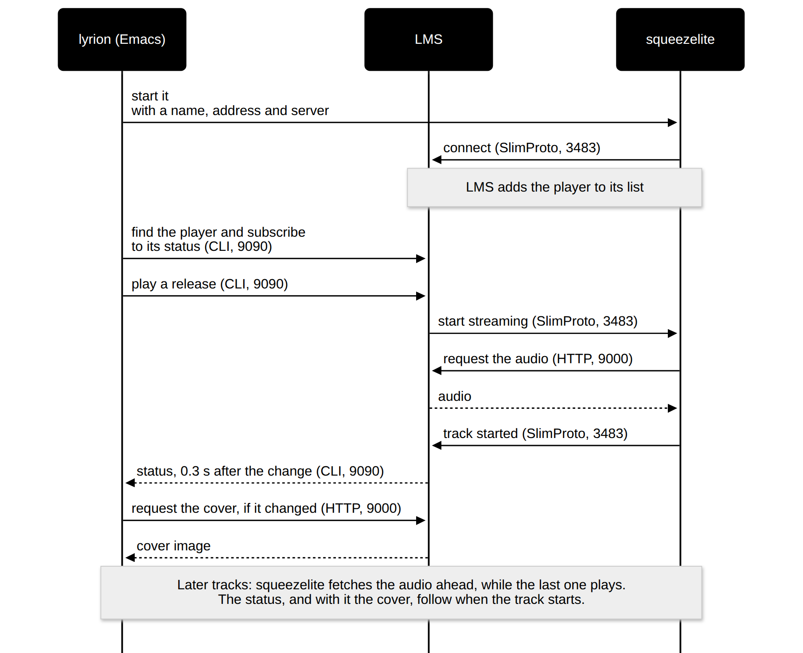
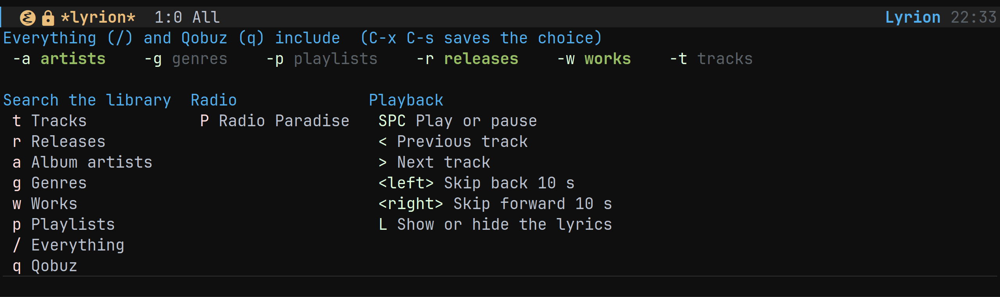
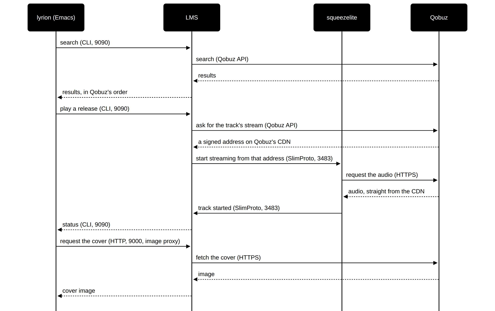
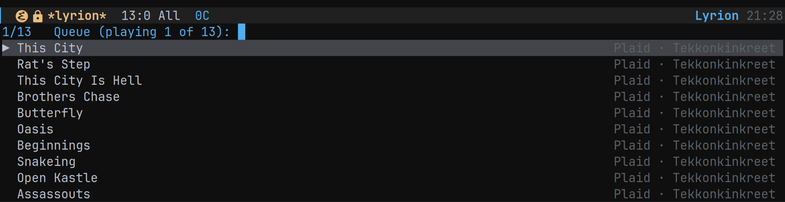

#+title: lyrion

[[https://github.com/codeasone/lyrion/actions/workflows/test.yml][https://github.com/codeasone/lyrion/actions/workflows/test.yml/badge.svg]] [[https://www.gnu.org/software/emacs/][https://img.shields.io/badge/Emacs-30.1%2B-7F5AB6.svg]] [[file:LICENSE][https://img.shields.io/badge/licence-CC0--1.0-lightgrey.svg]]

A minimal Emacs front end for a [[https://lyrion.org][Lyrion Music Server]] (=LMS=).

It shows what a player is playing, searches the library and plays what you pick, and controls playback on any of the server's players or on this computer.

#+attr_html: :width 900px
#+attr_org: :width 900

=lyrion= is not affiliated with or endorsed by the Lyrion Music Server project.

* What it does

- A read-only buffer shows what's playing as a card centred in the window: the cover, track number and title, artist, album and year, a progress bar with the elapsed and total times, the track up next, and the player's name and state.
- A pane beside the card shows the track's lyrics from =LRCLIB=. With timed lyrics, the line being sung is highlighted and kept in view.
- A transient menu picks what to search: tracks, releases, album artists, genres, works, playlists or everything. When the server has the Qobuz or Radio Paradise plugin installed, it also searches Qobuz or plays Radio Paradise's channels.
- You pick a result with whatever completion UI you use, such as =vertico=. It plays in order or shuffled, or, for an artist, opens their releases so you can choose one.
- Single keys control playback, the volume, shuffle and repeat, smart crossfading and a sleep timer, and switch between the server's players. [[#keys][Keys]] lists them all.
- You can inspect the queue in play order and jump to any track in it, as described under [[#the-queue][The queue]].
- =lyrion= can start =squeezelite= so the music plays on this computer. It runs under a stable name and address, so =LMS= keeps the player's settings from one session to the next.

There is no library browser, but searching with =/= goes a long way towards one. The completions cover the whole library, and with a vertical completion UI such as =vertico= you can scroll through it before typing anything, then narrow it by artist, year or other details, as described under [[#searching][Searching]]. With =prescient=, what you played recently or often comes first.

* Design

- =lyrion= is one file and needs nothing beyond Emacs 30 or later and its built-in =transient=. If =nerd-icons= is installed, it uses it for icons.
- The server owns the queue, along with each player's shuffle, repeat and crossfade settings. =lyrion= shows those settings and the sleep timer, and fetches the queue afresh whenever you ask to see it, so it keeps no copy of its own.
- Choosing something to play replaces the queue on the server, and the next and previous keys move through it there. =lyrion= never edits the queue; to change it, choose something else to play.
- Nothing is polled. =lyrion= keeps one connection open to the server's CLI on port 9090 (=LMS= calls it a command-line interface, but it is a line-based text protocol over TCP) and subscribes to the player's status. The server sends the full status whenever anything changes, and Emacs counts the elapsed time in between.
- Covers come from the server's web port and lyrics from =LRCLIB= over TLS. Both are fetched with a few lines of HTTP/1.0 over network processes rather than =url.el=, and every request has a timeout.
- Search lists the library once a session, on separate connections, starting in the background when the menu opens, so it never holds up the now-playing card.
- The player and the lyrics are =special-mode= buffers: single keys run commands, and there is nothing to edit. The same keys work in both, but for =q=, which in the lyrics hides them alone.
- Everything is meant to be done from the keyboard, and =?= lists every key. Mouse support is not a goal; whatever a click happens to do comes from Emacs itself.

#+attr_html: :width 900px
#+attr_org: :width 900

* Install

#+begin_src elisp
(use-package lyrion
  :vc (:url "https://github.com/codeasone/lyrion" :rev :newest)
  :custom
  (lyrion-host "lms.lan")
  ;; Play on this computer, through squeezelite.
  (lyrion-player 'local)
  ;; Full volume, so the system volume keys set the level.
  (lyrion-local-volume 100))
#+end_src

=M-x lyrion= opens the player.

=lyrion= works with any completion interface, but it is made for =vertico=, which I use and recommend. Only with =vertico= do long results fit the window and the selected one scroll, as described under [[#searching][Searching]], and the queue open with the cursor on the track playing. Emacs's built-in =fido-vertical-mode= also lists the results as you type. With Emacs's default completion, matches show only after =TAB=, which is hard going in a large library.

* Getting started

=lyrion= needs an =LMS= it can reach and a player to show.

** The server
:PROPERTIES:
:CUSTOM_ID: the-server
:END:

Set ~lyrion-host~ to the server's host name or address.

=LMS= listens on three ports, shown here with their defaults. If your server uses others for the CLI or the web server, set ~lyrion-cli-port~ or ~lyrion-http-port~.

| Port | What =LMS= serves there                                        | Used by                                |
|------+----------------------------------------------------------------+----------------------------------------|
| 9090 | the CLI: commands, and status sent as it changes               | =lyrion=                               |
| 9000 | its web server: the web interface, JSON-RPC, covers, and audio | =lyrion= for covers; players for audio |
| 3483 | [[https://wiki.lyrion.org/index.php/SlimProto_TCP_protocol.html][SlimProto]], which tells players what to play and when           | players, such as =squeezelite=         |

A player connects on 3483 and waits there for commands. When told to play, it fetches the audio over HTTP from 9000 and tells the server when the track starts. About 0.3 s later the server sends =lyrion= the new status, and =lyrion= fetches the cover if it has changed. =lyrion= never handles the audio itself.

Qobuz takes a different route: the player fetches its audio from Qobuz directly, as shown under [[#qobuz][Qobuz]].

#+attr_html: :width 572px
#+attr_org: :width 572

** A player

Either show a player the server already has, or make this computer one.

To use an existing player, such as a network streamer or a =squeezelite= on another machine, leave ~lyrion-player~ =nil= to show whichever is playing, or set it to the player's name.

For example, to show the WiiM Ultra whenever =lyrion= opens:

#+begin_src elisp
(use-package lyrion
  ;; ...
  :custom
  (lyrion-host "lms.lan")
  (lyrion-player "WiiM Ultra"))
#+end_src

The name is the one =LMS= shows, as listed by =p=; case does not matter. A player's id, its MAC address, works too. If no player has that name, the player buffer says so and keeps looking.

=p= switches between players at any time.

#+attr_html: :width 900px
#+attr_org: :width 900
[[file:images/players.png]]

The steps below are for Linux. =squeezelite= runs on macOS and Windows too, so they should adapt; pull requests adding instructions for either are welcome.

To play on this computer:

1. Install =squeezelite=, for example with =sudo apt install squeezelite=.
2. If the package enabled its own system service, disable it with =sudo systemctl disable --now squeezelite=. The service would run a second player that may hold the sound card.
3. =squeezelite -l= lists the output devices. If the default does not play, pass one of those names through ~lyrion-squeezelite-arguments~, such as =("-o" "pipewire")=.
4. Set ~lyrion-player~ to ~local~ and run =M-x lyrion=.

You do not need to add the player to =LMS=: as the [[#the-server][sequence diagram]] above shows, it joins the server's list when it connects.

Its name is ~lyrion-squeezelite-name~, *"Emacs on"* followed by this computer's host name by default. Its address derives from the name, so the server keeps its settings, such as volume and ReplayGain, between sessions. A new name makes a new player.

If the player buffer stays on "Waiting for NAME to connect", check that this computer can reach port 3483 on the server; if it connects but plays no sound, check port 9000.

=squeezelite='s own output is in the =*lyrion squeezelite*= buffer.

* Keys
:PROPERTIES:
:CUSTOM_ID: keys
:END:

In the player and in the lyrics:

| Key     | Action                                                     |
|---------+------------------------------------------------------------|
| =SPC=   | play or pause                                              |
| =<= =>= | previous or next track in the queue                        |
| =←= =→= | skip back or forward ~lyrion-skip-seconds~                 |
| =+= =-= | volume up or down ~lyrion-volume-step~, or ~=~ for up      |
| =p=     | choose the player                                          |
| =S=     | turn shuffle on or off; the track playing carries on       |
| =S-RET= | shuffle the queue afresh and play it from the top          |
| =O=     | play the queue in order, from its first track              |
| =R=     | cycle repeat through off, track and all                    |
| =X=     | turn smart crossfading on or off                           |
| =/=     | search the library or Qobuz and play                       |
| =L=     | show or hide the lyrics                                    |
| =C=     | copy the lyrics shown, without times or empty lines        |
| =w=     | copy the track as "Artist - Release - Title"               |
| =Z=     | sleep in 15 to 90 minutes, fading out, or cancel it        |
| =I=     | inspect the queue, in play order, and jump to a track      |
| =g=     | reconnect (player) or fetch the lyrics again (lyrics)      |
| =q=     | hide the lyrics, or bury the player                        |
| =?=     | show every key in a menu, with repeat, crossfade and sleep |

=/= opens a transient menu:

#+attr_html: :width 900px
#+attr_org: :width 900

=q= and =P= appear only when the server has the Qobuz or Radio Paradise plugin. The playback keys work in the menu too and keep it open, as does =L= for the lyrics.

Above the searches, switches choose the categories that an /Everything/ search (=/=) and a Qobuz search (=q=) include. Each shows as its key and name, lit when on and dimmed when off. All are on at first; press a switch's key to turn it off or on again:

| Switch | Category                                 |
|--------+------------------------------------------|
| =-a=   | artists: album artists, or Qobuz artists |
| =-g=   | genres (library only)                    |
| =-p=   | playlists                                |
| =-r=   | releases                                 |
| =-w=   | works (library only)                     |
| =-t=   | tracks                                   |

Switches last only while the menu is open, unless you keep them with one of transient's own keys, which work in any transient menu:

- =C-x s= sets them for the rest of this Emacs session.
- =C-x C-s= saves them for later sessions too, in transient's =transient-values-file=. The menu's heading reminds you of this key.

The switches affect only =/= and =q=. The keys that search one category, such as =t= for tracks or =p= for playlists, always search it, even when its switch is off.

** Playing what you choose
:PROPERTIES:
:CUSTOM_ID: choosing
:END:

Every search ends in the minibuffer, and the key you choose a result with decides what happens to it. The same three keys work in every search, of the library or of Qobuz:

| Key     | What happens to the result                                                     |
|---------+--------------------------------------------------------------------------------|
| =RET=   | it plays, in order                                                             |
| =S-RET= | it plays, shuffled                                                             |
| =M-RET= | an artist lists their releases to pick from; anything else plays as with =RET= |

What plays depends on the kind of result:

| Result                             | What =RET= and =S-RET= play                                |
|------------------------------------+------------------------------------------------------------|
| a track                            | the track on its own                                       |
| a release                          | the whole release                                          |
| an album artist                    | everything by them                                         |
| a genre                            | everything in it                                           |
| a work                             | the recording on that release                              |
| a playlist                         | the whole playlist                                         |
| a Qobuz artist                     | their songs, as Qobuz finds them for their name, up to 200 |
| a Qobuz release, track or playlist | the release, track or playlist                             |

=M-RET= differs from =RET= only on an artist, from the library or Qobuz: instead of playing them, it lists their releases. Among those, the keys start afresh: =RET= plays the release you pick and =S-RET= shuffles it. The prompt names the keys as a reminder, and mentions =M-RET= whenever there are artists among the results.

* Searching
:PROPERTIES:
:CUSTOM_ID: searching
:END:

Each result has an icon for its kind and some dimmed details:

- a track shows its artist and album;
- a release shows its artist and year;
- a work shows its composer and release.

The details match what you type too, so typing =hiromi clair= narrows the many recordings of Clair de Lune to Hiromi's. In a release search, an artist's name lists their releases with their years, and a year such as =1983= lists what came out that year.

With =vertico=, a result too wide for the window is shortened with an ellipsis, its details first and then its name. The selected result instead scrolls to its end and back to its start, so you can read it all. Set ~lyrion-search-scroll~ to nil to stop it scrolling. The queue does the same.

An /Everything/ search groups the results in this order: album artists, genres, playlists, releases, works and tracks. Categories you have switched off are left out.

#+attr_html: :width 900px
#+attr_org: :width 900
[[file:images/search.png]]

How well search works depends heavily on the quality of your collection's metadata and tags.

A work recorded on several releases gives one result per release, so each recording can be chosen. Works need =LMS= 9 or later.

Results are sorted alphabetically, ignoring case. When =prescient= sorts the completions, recent and frequent choices come first. Its length rule is turned off, as length means little for music. When two results have the same text, a number tells them apart.

=lyrion= lists the library once a session. Press =g= in the player to list it again at the next search.

* Qobuz
:PROPERTIES:
:CUSTOM_ID: qobuz
:END:

When the server has the [[https://www.qobuz.com][Qobuz]] plugin, =q= in the search menu searches Qobuz and streams what you choose.

It searches whichever of artists, playlists, releases and tracks are switched on; works and genres exist only in the library. Results are grouped as in an /Everything/ search, and each group keeps Qobuz's order, most relevant first. Releases show their artist and year, and tracks their artist and release, as in the library. =lyrion-qobuz-results= sets how many results come back in each group.

An artist plays their songs: up to 200 tracks that the plugin finds by searching Qobuz for their name, in the order Qobuz ranks them. =M-RET= opens the artist into their releases instead, as described under [[#choosing][Playing what you choose]].

=lyrion= asks the server whether it has the plugin the first time the search menu opens in a session, and waits up to two seconds for the answer. If the server does not answer in time, it asks again at the next search. If you install the plugin while =lyrion= is running, press =g= in the player to ask again.

The audio does not pass through =LMS=. For each track, =LMS= asks Qobuz for a signed address on Qobuz's content delivery network, and the player streams from there over HTTPS. Covers come from Qobuz through =LMS='s image proxy.

#+attr_html: :width 800px
#+attr_org: :width 800

** Setting up the plugin

You need a Qobuz subscription. In the =LMS= web interface:

1. Open /Settings/, then /Manage Plugins/. =LMS= downloads its list of plugins from the =LMS= community's repository on GitHub.
2. Find Qobuz under /Streaming Services/, or type its name in the search box. Tick it, apply the change and let =LMS= restart.
3. Open the Qobuz plugin's settings and sign in with your Qobuz account.
4. Set the options below, and save.

These settings suit =lyrion=. Leave the others at their defaults.

| Setting                                  | Value       | Why                                                                                                                                                     |
|------------------------------------------+-------------+---------------------------------------------------------------------------------------------------------------------------------------------------------|
| Import                                   | No          | Imported Qobuz favourites would join the library and appear among library results.                                                                      |
| Play samples                             | off         | A track Qobuz will not stream would otherwise play as a 30-second sample, marked only by an asterisk.                                                   |
| Show Release Year with Albums            | Yes         | Releases then show their year in the results.                                                                                                           |
| Show Composer with Artist                | Yes         | Classical results then name the composer as well as the performers.                                                                                     |
| Show recording version with track titles | Yes         | Track titles then tell remasters and live recordings apart.                                                                                             |
| Hide AI-generated releases               | on          | Generated albums stay out of the results.                                                                                                               |
| Preferred format                         | your choice | It applies to every player, and a player can only lower it. To cap this computer at CD quality, set ~lyrion-squeezelite-arguments~ to =("-r" "44100")=. |

If results come back but nothing plays, open /Settings/, /Advanced/, /Network/ and check /Web proxy/. Unless you use a proxy, it must be empty. A value such as =http://192.168.1.10:9000= stops =LMS= fetching anything over plain HTTP, such as Radio Paradise's covers.

* Radio Paradise

When the server has the [[https://radioparadise.com][Radio Paradise]] plugin, =P= in the search menu lists its channels, such as Main Mix and Mellow Mix, in the plugin's order. The channel you choose replaces the queue. When a channel has several streams, =lyrion= plays the first, which is the plugin's best, FLAC. That stream also lets the server skip songs.

Each song in the FLAC stream is a block of its own, which =LMS= fetches from Radio Paradise and relays to the player. Each block brings the song's title and cover, so the card follows the songs although the channel stays the same.

#+attr_html: :width 762px
#+attr_org: :width 762
[[file:images/radio-paradise.png]]

* The queue
:PROPERTIES:
:CUSTOM_ID: the-queue
:END:

=I= lists the queue in the order it plays, shuffled or not.

- The track playing is marked ▶. With =vertico=, the cursor starts on it, so the tracks before and after it are a few keys away; other completion interfaces start at the first track.
- Each line shows the track's title, artist and album, and all of them match what you type, so =planet= finds any title with that word.
- Lines have no numbers, so they can't be confused with a track's number on its release, which the player shows. The prompt says where you are instead, as in /playing 12 of 40/.
- A track queued twice has /(2)/ after its second copy.

=RET= plays the chosen track where it stands, without loading or reshuffling the queue again. On the track already playing, it starts that track again. To close the queue without changing anything, press =C-g=. The list keeps the queue's order whatever your completion UI would sort by.

#+attr_html: :width 900px
#+attr_org: :width 900

* Players

With ~lyrion-player~ set to =nil=, =lyrion= shows the first connected player that is playing, or failing that the first connected player. A name or id picks a specific player, and ~local~ starts =squeezelite= and shows this computer.

=p= chooses among the server's players for the rest of the session. This computer is always on the list, and choosing it starts =squeezelite= if it is not running. If a =squeezelite= with this computer's address is already running, =lyrion= uses it instead of starting another.

=squeezelite= keeps running after the player's buffer is closed, so closing =lyrion= does not stop the music. =M-x lyrion-local-player-stop= stops it, as does killing the =*lyrion squeezelite*= buffer or quitting Emacs.

* Crossfading

=X= turns smart crossfading on or off. In =LMS='s words, "successive tracks played from the same album will not use the Crossfade setting", so albums stay gapless. Before =LMS= 9.2, it may not fade where one album runs into the next either. The fade's length is the player's own setting, shown in the player line, as in /smart crossfade 10 s/. You can change it in the player's audio settings in the =LMS= web interface.

* Lyrics

=lyrion= fetches lyrics from [[https://lrclib.net][LRCLIB]] only while the lyrics are shown, sending the track's artist, title, album and length. It asks for an exact match first; failing that, it takes the search result closest in length, within ten seconds. Answers, misses included, are kept for the session. Failed requests are not, so =g= tries again.

Timed lyrics are best effort. LRCLIB is an open database that anyone can add lyrics to, anonymously, so its timings are only as good as whoever synced them, each for one recording. The closest match in length may also be a different edit or master. Lines can then light up a little early or late, or drift as the song goes on. =lyrion= lights each line 0.3 s before its time, as singers tend to come in slightly early.

* Authentication

Not supported yet. =lyrion= connects to the server without a user name or password, which suits a server on a home network with password protection off. It could be added: =LMS='s CLI accepts =login USER PASSWORD= as its first command, and its web port accepts basic authentication, so both connections could log in when a password is set.

* Options

| Option                           | Default                  | Meaning                                                    |
|----------------------------------+--------------------------+------------------------------------------------------------|
| ~lyrion-host~                    | ="localhost"=            | the server                                                 |
| ~lyrion-cli-port~                | ~9090~                   | its CLI                                                    |
| ~lyrion-http-port~               | ~9000~                   | its web interface, for covers                              |
| ~lyrion-player~                  | ~nil~                    | a player's name or id, ~local~, or nil for the one playing |
| ~lyrion-squeezelite-program~     | ="squeezelite"=          | the program that makes this computer a player              |
| ~lyrion-squeezelite-name~        | ="Emacs on HOST"=        | this computer's player's name; its address derives from it |
| ~lyrion-squeezelite-arguments~   | ~nil~                    | further arguments, such as =("-o" "pipewire")=             |
| ~lyrion-squeezelite-idle-close~  | ~5~                      | seconds of silence before the sound device is released     |
| ~lyrion-local-volume~            | ~nil~                    | volume set on this computer's player when it starts        |
| ~lyrion-skip-seconds~            | ~10~                     | seconds the arrow keys skip                                |
| ~lyrion-volume-step~             | ~5~                      | the volume change per key press, out of 100                |
| ~lyrion-cover-size~              | ~32~                     | the cover's longest side, in em                            |
| ~lyrion-progress-width~          | ~32~                     | the progress bar's width, in columns                       |
| ~lyrion-reconnect-delay~         | ~5~                      | seconds to wait before reconnecting after a drop           |
| ~lyrion-lyrics-url~              | ~https://lrclib.net/api~ | where the lyrics come from                                 |
| ~lyrion-lyrics-side~             | ~right~                  | the side the lyrics open on                                |
| ~lyrion-lyrics-size~             | ~0.33~                   | their share of the frame                                   |
| ~lyrion-lyrics-select-window~    | ~t~                      | move point into the lyrics when they open                  |
| ~lyrion-lyrics-hide-empty-lines~ | ~t~                      | leave out lines with no words                              |
| ~lyrion-qobuz-results~           | ~100~                    | the most Qobuz results shown of each kind                  |
| ~lyrion-search-scroll~           | ~t~                      | scroll the selected result when too wide (=vertico=)       |

* Known issues

A few commands need an answer from the server before they can show anything, and Emacs waits for it. On a home network most waits are too short to notice. These are the times measured against my own server, =LMS= 9.1.2:

| Command                   | Waits for                                       | Typical wait   | Gives up after |
|---------------------------+-------------------------------------------------+----------------+----------------|
| =p=                       | the server's players                            | 0.01 s         | 5 s            |
| =I=                       | the queue                                       | 0.01 s         | 5 s            |
| =/= =P=                   | Radio Paradise's channels                       | 0.01 s         | 5 s            |
| =/= =q=                   | a Qobuz search, which the server asks Qobuz     | 1.2 s          | 15 s           |
| =/= =t=, =r=, =a=, ...    | the library, listed once a session              | up to 1.6 s    | 30 s           |
| =M-RET= on an artist      | their releases                                  | 0.04 s         | 5 s            |
| =M-RET= on a Qobuz artist | their releases, which the server asks Qobuz for | 0.06 to 0.24 s | 15 s           |

The library is listed in the background as soon as the search menu opens, so it is usually ready by the time you choose what to search.

A wait is noticeable only when the server stops answering. After a second, the echo area says what =lyrion= is waiting for, and =C-g= stops the wait at once. When =lyrion= already knows that the connection is down, it says so straight away instead of waiting.

* Tested on

=lyrion= has only been tested on my own system, described below. Elsewhere it may need changes.

| Part          | What I use                                                                              |
|---------------+-----------------------------------------------------------------------------------------|
| Desktop       | Linux Mint 22.3, kernel 7.0, X11                                                        |
| Emacs         | GNU Emacs 30.2 (GTK3, native compilation), with =vertico=, =prescient= and =nerd-icons= |
| Sound         | PipeWire 1.0.5, through its PulseAudio server                                           |
| =squeezelite= | 1.9.9                                                                                   |
| Server        | =LMS= 9.1.2, the =lmscommunity/lyrionmusicserver= Docker image on Debian 12             |
| Players       | this computer, through =squeezelite=, and a [[https://www.wiimhome.com/wiimultra/overview][WiiM Ultra]]                                  |

I haven't tried it on macOS, Windows or Wayland, with a completion interface other than =vertico=, or with a server older than =LMS= 9. CI runs the tests against a fake server on Emacs 30.1, the oldest version =lyrion= supports.

* AI assistance

=lyrion= was developed with Claude Opus 5.5 in Claude Code: it wrote the code, the tests and most of this documentation. I set the design, used my discernment to guide the implementation and the quality checks, reviewed the code, and tested it against my own =LMS= server.

I never intended to share "AI-written" work on my GitHub profile, but =lyrion= has worked out so nicely that I feel compelled to.

If it serves no other purpose than to inspire remixes of your own, that's reason enough.

* Licence

=lyrion= is dedicated to the public domain under [[https://creativecommons.org/publicdomain/zero/1.0/][CC0 1.0 Universal]]: use it, change it and share it however you like, with no need to ask or credit anyone. No copyright is claimed, since the code was written by an AI model; where the law does not allow a waiver, CC0 grants the same freedoms as a licence. The full text is in =LICENSE=.

* Development

=make test= runs the test suite. =make lint= byte-compiles with warnings as errors and runs =checkdoc=.

Both run Emacs headless, with no display or input. The tests talk to a fake server on loopback ports, so you don't need a real =LMS=. On every push and pull request, GitHub Actions runs both on Emacs 30.1.

The sequence diagrams are drawn from =images/ports.mmd=, =images/qobuz.mmd= and =images/radio-paradise.mmd=. After changing one, render it again with =mmdc -i images/NAME.mmd -o images/NAME.png -b white -s 2=.
